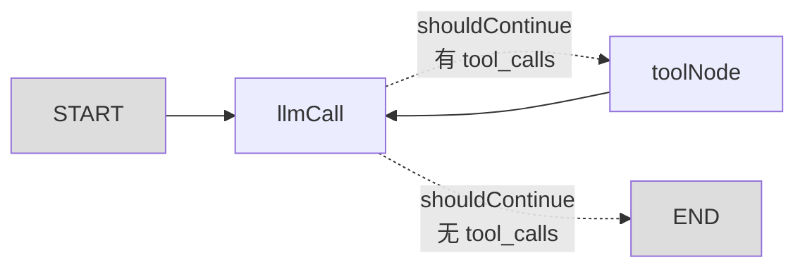

# 状态图设计练习与错因复盘

> **第 1 周** · 2026-11-02 ~ 11-03
> **对应计划**：第 1 周「画出一个最简对话 Agent 的状态流转图」
> **练习方式**：给命题 → 口述作答 → 批改纠正（不会画图，用文字描述结构）

---

## 为什么有这份笔记

同一天连做三轮练习，暴露的错误高度集中，且**同一个坑踩了两次**：

| 轮次 | 得分 | 核心问题 |
| --- | --- | --- |
| 练习一 | 约 25% | 把 Quickstart 的**工具循环**套进了**无工具**场景 |
| 练习二 | 约 50% | **路由当成节点**、工具放进 state |
| 练习三 | 16 / 20 | 节点/路由/state 边界基本掌握，剩机制细节 |

**这份笔记的价值在"错因轨迹"**——它记录的是从"照着抄"到"会设计"的过程。

---

## 一、核心知识模型：三层区分

任何 LangGraph 设计，先说清这三层：

| 层 | 是什么 | 判断标准 | 画图位置 |
| --- | --- | --- | --- |
| **节点（Node）** | 干活的函数 | 返回**状态更新对象**，会改变 state | **方块** |
| **路由（Router）** | 分岔判断 | 返回**节点名字符串**或 `END`，**不改 state** | **边上的标签**（不是方块） |
| **State** | 流转的数据 | 只装**可序列化的数据**，不装能力/函数 | 单独的规格说明 |

### 一句话区分

> **节点是工人，路由是路牌。路牌不干活。**

---

## 二、练习一：最简对话 Agent（无工具）

### 命题

电商客服「最简多轮对话 Agent」：

- 用户可连续多轮提问
- 要记得历史（第二轮能理解"那件衣服"的指代）
- 流式返回
- **不调用任何工具**

### 我的作答

1. **五个节点**：接收用户 message / 调用 llm 分析吐出回答 / 满足则 END / 不满足继续喂 llm / 吐出最终答案
2. **State**：存用户的问题 + 历史对话
3. **边**：入口从 llm 吐出答案开始
4. **多轮记忆**：有个构造函数，官方封装好的

### 批改

| 问题 | 错在哪 |
| --- | --- |
| 节点 5 个 | **实际只有 1 个**。多出来的全是"把工具循环套进无工具场景" |
| "接收用户 message" 是节点 | ❌ 它是 `invoke()` 的**入参**，不是节点 |
| "满足则 END / 不满足继续" | ❌ 无工具就没有"不满足"这回事，没有分支 |
| "吐出最终答案"是独立节点 | ❌ 就是 `llmCall` 的输出，同一个节点 |
| State 两个字段 | ❌ "用户的问题"本来就是 messages 里的一条，**重复了** |
| 入口从 llm 开始 | ❌ 入口是 `START` |
| 第四问 | 方向对（是 checkpointer），但没说清机制 |

### ✅ 正确答案

**节点（1 个）**

| 节点 | 作用 |
| --- | --- |
| `llmCall` | `[SystemMessage, ...state.messages]` → 模型 → 返回 `{ messages: [response] }` |

**State（1 个字段）**

| 字段 | 类型 | 说明 |
| --- | --- | --- |
| `messages` | `MessagesValue` | 完整对话历史（用户问题也在里面） |

**边（2 条，无条件边）**


**多轮记忆：checkpointer + thread_id**

```ts
import { MemorySaver } from "@langchain/langgraph";

const checkpointer = new MemorySaver();
const agent = workflow.compile({ checkpointer });

const config = { configurable: { thread_id: "user_123" } };

await agent.invoke({ messages: [new HumanMessage("你好")] }, config);
await agent.invoke({ messages: [new HumanMessage("那件衣服有大码吗")] }, config);
//          ↑ 只传新的这条                          ↑ 同一个 thread_id
```

LangGraph 按 `thread_id` 自动恢复上次状态，与本次输入合并（`MessagesValue` 负责追加）。

> 另一种做法（不用 checkpointer）：每次 invoke 传完整历史，记忆存在调用方。Demo0 推荐用 checkpointer。

### 💡 关键教训

> **图的复杂度来自「分支」，不来自「功能数量」。**
> 无工具 = 无分支 = 1 个节点。

---

## 三、练习二：加一个工具

### 命题

在练习一基础上，加一个「查物流」工具。图会变成什么样？

### 我的作答

1. **再加一个 `shouldContinue` 节点**，那就是两个节点
2. 因为要调用工具循环答题，**首次输出的答案可能不满足最终要求**，需要二次调用工具，因此有条件边
3. State 要两个字段：`message` 和**工具 map**

### 批改

| 问题 | 错在哪 |
| --- | --- |
| `shouldContinue` 是节点 | ❌ **它是路由，不是节点**（同一类错误的第二次） |
| "答案不满足 → 调工具" | ❌ 理解反了。模型**不会先给不满足的答案**，它直接返回 `tool_calls` |
| 工具 map 进 state | ❌ 函数不可序列化，checkpointer 会报错；且工具是能力不是数据 |

### ✅ 正确答案

**节点（2 个）+ 路由（1 个）**

| 类型 | 名称 | 作用 |
| --- | --- | --- |
| 节点 | `llmCall` | 发历史给模型，拿回"回答"或"工具请求" |
| 节点 | `toolNode` | 执行工具，结果追加回 messages |
| **路由** | `shouldContinue` | 看最后一条有没有 `tool_calls`，决定去 `toolNode` 还是 `END` |

**State（仍是 1 个字段）**：`messages`

**工具**：模块顶层的 `toolsByName` 常量，**不在 state 里**



> 虚线表示：`shouldContinue` 是**边上的标签**，不是图里的方块。

### 💡 关键教训

> **路由看结构，不看质量。**
> 判断的是 `tool_calls.length > 0`，不是"答案好不好"。

### 为什么工具不能进 state

| 理由 | 说明 |
| --- | --- |
| 不可序列化 | 工具是函数，checkpointer 存 checkpoint 时会报错 |
| 不需要传递 | 模块加载时就有了，所有节点直接引用 |
| 违反设计原则 | state 只装数据，不装能力 |

**类比：State 是「货」，工具是「手」。装箱子时装货，不会把手装进去。**

---

## 四、练习三：两个工具

### 命题

商品问答 Agent，2 个工具（`queryPrice` 查价格、`queryStock` 查库存），部分问题无需工具。

五问：① 几个节点 ② 几个路由/判断什么 ③ State 字段 ④ 工具放哪 ⑤ 一次调两个工具会怎样

### 我的作答

1. 2 个节点：message + tool
2. 1 个路由，判断用 tool 还是 llm 答案直出
3. State 一个字段，存 message
4. 放在 tool 注册的时候，定义在函数外（**不确定**）
5. 拿到两个工具结果后，处理 message 合并后返回（**不确定**）

### 批改：16 / 20 ✅

| 题 | 得分 | 评价 |
| --- | --- | --- |
| ① | 4/5 | 数量对，名字要改：`message` → `llmCall` |
| ② | 3/4 | 方向对，机制要精确：看 `tool_calls`，不是"判断要不要用工具" |
| ③ | 4/4 | **完全正确** |
| ④ | 3/3 | **答对了**，只是不自信 |
| ⑤ | 2/4 | 方向对（结果合并），漏了核心机制：`for` 循环 |

### ⑤ 详解：多工具处理

```ts
const result: ToolMessage[] = [];
for (const toolCall of lastMessage.tool_calls ?? []) {   // ← 关键：循环
  const tool = toolsByName[toolCall.name];
  const observation = await tool.invoke(toolCall);
  result.push(observation);
}
return { messages: result };
```

**执行过程**：

```
模型返回 tool_calls = [
  { name: "queryPrice", args: {...}, id: "call_1" },
  { name: "queryStock", args: {...}, id: "call_2" },
]

toolNode：
  第 1 轮 → queryPrice → ToolMessage(tool_call_id: "call_1")
  第 2 轮 → queryStock → ToolMessage(tool_call_id: "call_2")

return { messages: [ToolMessage1, ToolMessage2] }
  → MessagesValue 追加两条
```

| 要点 | 说明 |
| --- | --- |
| 是 `for` 循环，不是"合并" | 两个工具**依次执行**（串行） |
| 每条结果各自带 `id` | 靠 `tool_call_id` 与请求配对 |
| 一次性返回数组 | 让 reducer 一次追加多条 |

> 要并行执行可改用 `Promise.all`，但 Quickstart 用串行。

### 💡 关键教训

> **节点命名用动词**（`llmCall` / `toolNode`），因为节点是"动作"不是"数据"。

---

## 五、错因轨迹

| 轮次 | 错误 | 根因 | 是否已修正 |
| --- | --- | --- | --- |
| 一 | 5 个节点 | 把工具循环套进无工具场景 | ✅ |
| 一 | State 存两个字段 | 没意识到"用户问题"已在 messages 里 | ✅ |
| 一 | 入口说成 llm | 混淆图结构和函数执行 | ✅ |
| 二 | `shouldContinue` 当节点 | **节点 vs 路由未区分** | ✅ |
| 二 | "答案不满足 → 调工具" | **在意图层思考，没到结构层** | ✅ |
| 二 | 工具 map 进 state | 混淆"数据"与"能力" | ✅ |
| 三 | 节点命名用名词 | 表述习惯 | ⚠️ 待巩固 |
| 三 | 多工具机制 | 没细看 `toolNode` 的 for 循环 | ⚠️ 待巩固 |

**规律**：所有错误都指向同一条 —— **把"意图层的想法"直接当成了"结构层的实现"**。

---

## 六、意图层 vs 结构层（最重要的认知）

| 你会想（意图层） | 代码实际看（结构层） |
| --- | --- |
| "要不要用工具" | `lastMessage.tool_calls?.length > 0` |
| "答案够不够好" | **不存在这个判断** |
| "两个结果合并" | `for` 循环收集成数组 |
| "下一步往哪走" | 路由返回**节点名字符串** |

> **Agent 的运行时只认结构信号。**
> 设计可以在意图层，但落地必须翻译成结构层判断。
> **两层能自由切换，就算真懂了。**

---

## 七、三句口诀

1. **节点干活，路由指路。** 路牌不产生数据。
2. **路由看结构，不看质量。** 判"有没有 tool_calls"，不判"答案好不好"。
3. **State 装货，不装手。** 函数 / 工具永远在模块顶层。

---

## 八、自查清单（下次设计前过一遍）

- [ ] 每个方块都是**干活的东西**吗？有没有把路由画成方块？
- [ ] 每个方块返回的是**状态更新**吗？（是字符串就是路由，不是节点）
- [ ] State 里每个字段：**真是数据吗？能序列化吗？能从别的字段推导出来吗？**
- [ ] 工具写在哪？**模块顶层**，不是 state
- [ ] 路由判断的是**结构信号**（字段存在/长度）还是"质量"？
- [ ] 用命名自检：节点用**动词**，state 字段用**名词**

---

## 九、和 Quickstart 的对照

| 概念 | Quickstart 精读笔记位置 |
| --- | --- |
| 节点 vs 路由 | 片段 5（`shouldContinue`） |
| Reducer / MessagesValue | 片段 2（State 定义） |
| 工具在模块顶层 | 片段 1（`toolsByName`） |
| for 循环执行多工具 | 片段 4（`toolNode`） |

---

*整理于 2026-11-03 · 三轮练习的真实作答与批改记录*
